# Hướng dẫn Sử dụng Webapp GKSK Lái Xe (Dành cho Nhân viên Y tế)

> **Phiên bản**: `1.0.0` · **Đối tượng sử dụng**: Nhân viên phòng Kế hoạch Tổng hợp / Khoa Khám sức khỏe lái xe tại Cơ sở y tế (CSYT).
>
> **Nguyên tắc làm việc cốt lõi**: Toàn bộ dữ liệu được nạp qua **file Excel** (xuất từ phần mềm HIS hoặc nhập theo file mẫu). Ứng dụng **không có màn hình gõ tay từng giấy**; nếu phát hiện dòng sai dữ liệu hoặc bị Sở từ chối, nhân viên chỉ cần sửa trực tiếp trên file Excel (hoặc file **Excel đối soát 29 cột**) rồi **Import đè lại** — hệ thống sẽ tự động đối chiếu theo cột **`SO`** (Số giấy).

---

## Tổng quan Quy trình 6 Bước

```text
[1. Đăng nhập] ──► [2. Tải mẫu & Import Excel] ──► [3. Kiểm tra 4 Tab Đối soát & Drawer chi tiết]
                                                               │
      ┌────────────────────────────────────────────────────────┘
      ▼
[4. Xuất XML (.xml / .zip)] ──► [5. Đẩy cổng Sở Y tế Đồng Nai] ──► [6. Xuất Excel đối soát 29 cột]
                                                                          │
                                          (Nếu có dòng lỗi/từ chối: Sửa ngay trên file Excel này rồi Import đè lại!)
```

---

## Bước 1 — Đăng nhập vào Hệ thống

1. Mở trình duyệt (Google Chrome hoặc Microsoft Edge) và truy cập địa chỉ nội bộ của cơ sở y tế (ví dụ `https://gksk.noibo.benhvien.local`).
2. Nhập **Tên đăng nhập** và **Mật khẩu** do bộ phận IT cấp, sau đó bấm **Đăng nhập**.
   - Nếu nhập sai mật khẩu quá **10 lần trong 15 phút**, hệ thống sẽ tạm khóa đăng nhập để bảo vệ an toàn.
   - Sau **8 giờ** không thao tác, phiên sẽ tự hết hạn và yêu cầu đăng nhập lại.

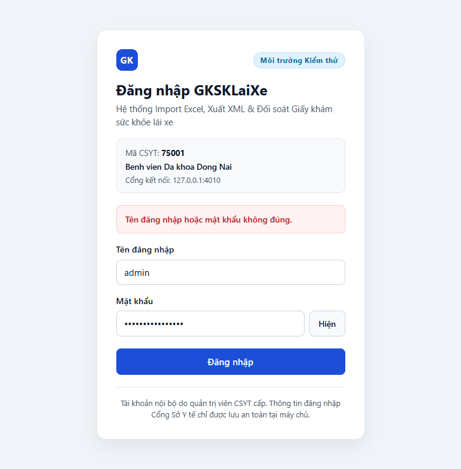

3. Sau khi đăng nhập thành công, giao diện chính hiển thị thanh điều hướng gồm đúng **2 mục**:
   - **Danh sách & Đối soát** (trang chủ)
   - **Import Excel**
   - Ở góc trên luôn hiển thị **Mã CSYT và Tên cơ sở y tế** đang cấu hình.
   - **Lưu ý quan trọng khi chạy môi trường Thật (`production`)**: Đầu trang sẽ hiển thị **thanh cảnh báo màu đỏ nổi bật** nhắc nhở dữ liệu sẽ được gửi trực tiếp lên Hệ thống Sở Y tế Đồng Nai.

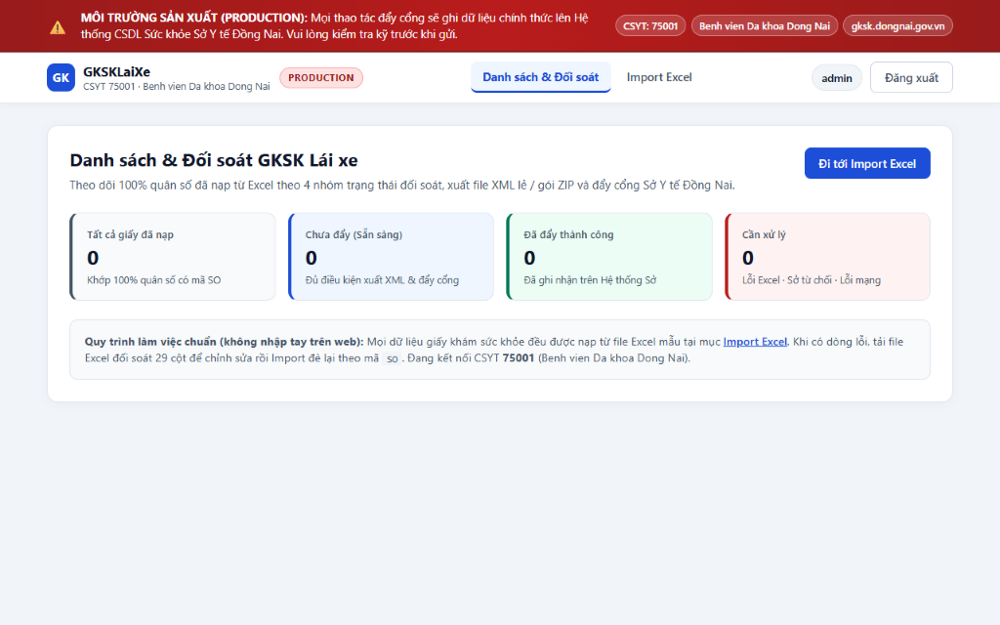

---

## Bước 2 — Tải File Excel Mẫu & Chuẩn bị Dữ liệu

1. Bấm vào mục **Import Excel** trên thanh điều hướng.
2. Bấm nút **Tải file Excel mẫu (`GKSK_mau_nhap_lieu.xlsx`)** để tải file chuẩn về máy.

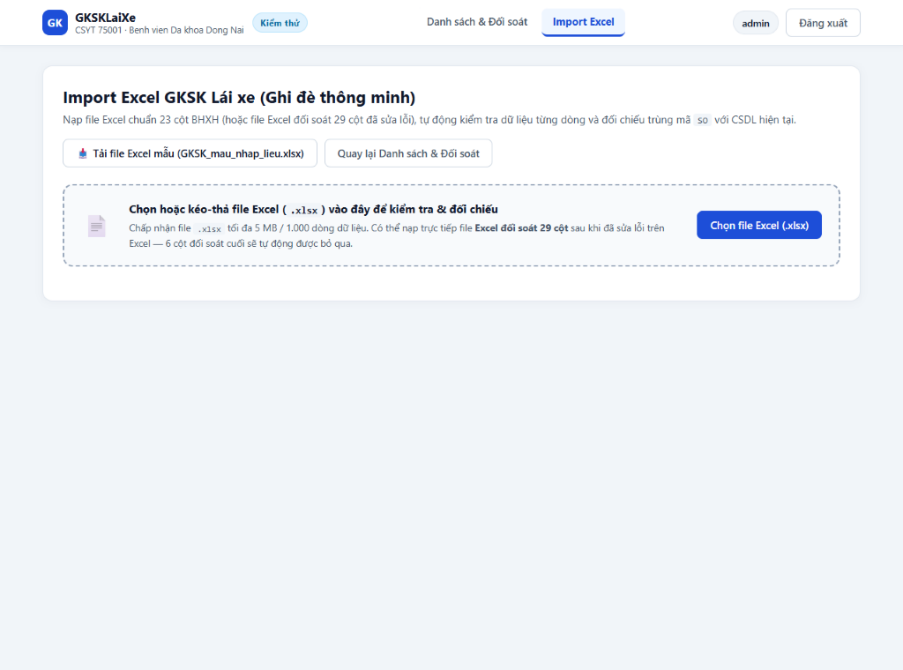

3. File mẫu gồm 2 trang tính (sheet):
   - **Sheet `GKSK`**: Gồm **23 cột dữ liệu** theo đúng chuẩn BHXH (2 cột `IDBENHVIEN` và `BENHVIEN` được hệ thống tự động điền từ cấu hình CSYT). Toàn bộ các ô đã được định dạng sẵn kiểu **Text (`@`)** để **không bị mất số `0` ở đầu số CCCD** (ví dụ `079000012345`) và không bị sai định dạng ngày.
   - **Sheet `HuongDan`**: Giải thích chi tiết ý nghĩa, quy định bắt buộc, độ dài tối đa và ví dụ mẫu của từng cột.

> **6 cột bắt buộc phải có mặt và có giá trị hợp lệ**:
> `SO` (Số giấy, ≤ 30 ký tự) · `HOTEN` (Họ tên) · `NGAYSINH` (`dd/MM/yyyy`) · `SOCMND_PASSPORT` (Số CCCD/CMND/Hộ chiếu) · `NGAYKETLUAN` (`dd/MM/yyyy`) · `KETLUAN` (`A0-1`, `A0-2` hoặc `A0-3`).

---

## Bước 3 — Import File Excel & Ghi đè Thông minh theo mã `SO`

1. Kéo thả hoặc bấm chọn file `.xlsx` (tối đa **5 MB** và **1.000 dòng** mỗi lần nạp).
2. Hệ thống tự động kiểm tra toàn bộ dữ liệu và đối chiếu mã **`SO`** với CSDL:
   - Nếu file thiếu một trong 6 cột bắt buộc (ví dụ thiếu cột `KETLUAN`), hệ thống sẽ chặn và báo rõ tên cột bị thiếu.

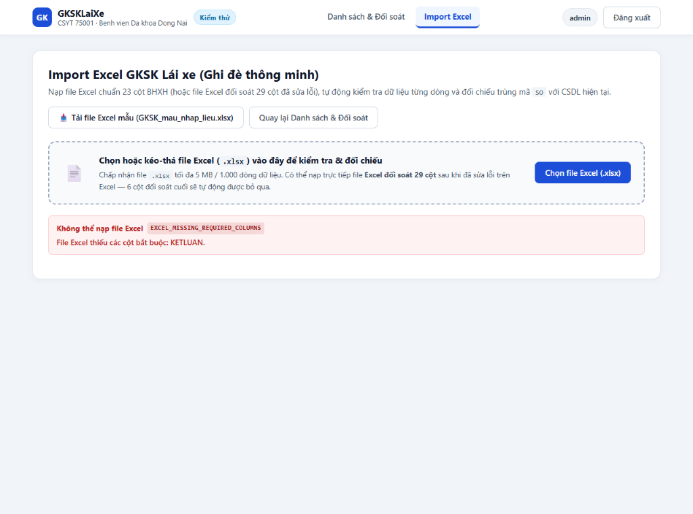

   - Với file đúng cấu trúc, màn hình hiển thị **5 thẻ thống kê** và **bảng xem trước từng dòng**:
     - **Dòng hợp lệ (`✅ Hợp lệ` / `⚠️ Có cảnh báo`)**: Mặc định **được tick chọn** để lưu ở trạng thái `Chờ đẩy cổng`.
     - **Dòng lỗi dữ liệu nhưng có mã `SO` (`⛔ Lỗi dữ liệu`)**: Vẫn **mặc định được tick chọn** lưu vào DB ở trạng thái `Lỗi dữ liệu Excel` để đảm bảo **khớp 100% quân số file Excel** khi đối soát (hệ thống sẽ khóa nút Đẩy cổng cho tới khi sửa xong).
     - **Dòng trống `SO` hoặc `SO` dài quá 30 ký tự**: Bị khóa checkbox, cần bổ sung mã `SO` trên Excel.

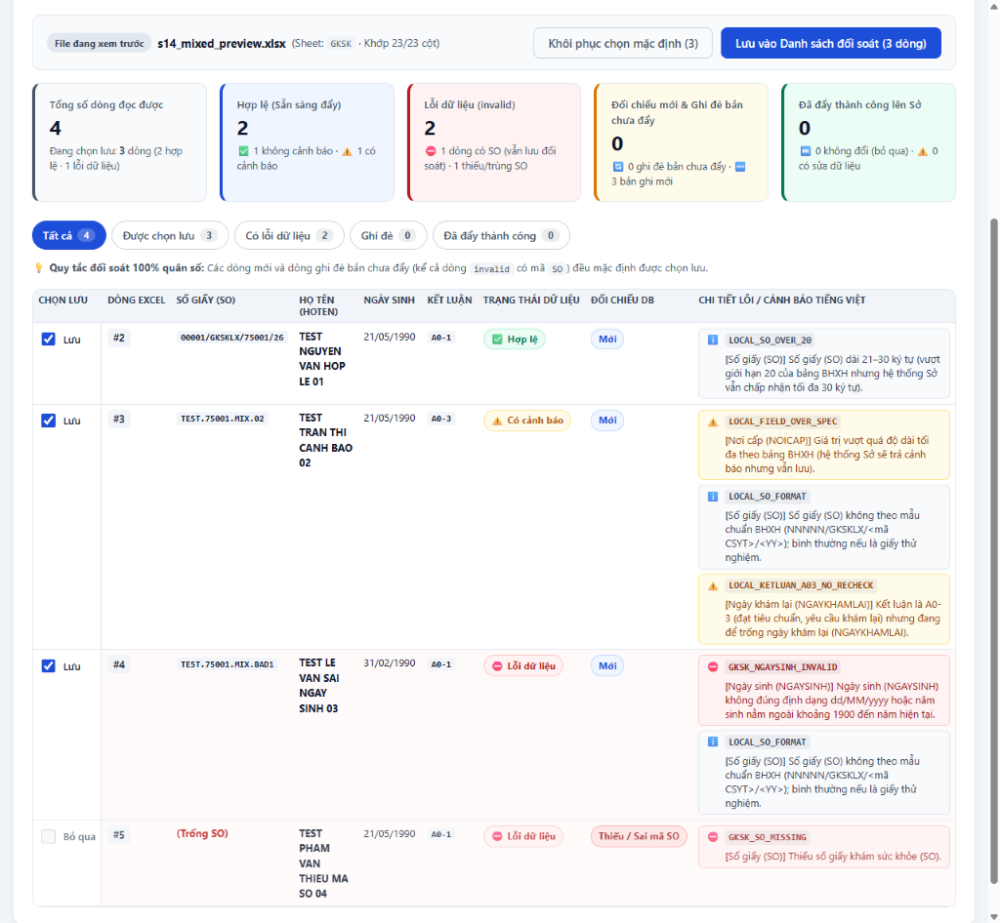

3. **Cơ chế Ghi đè thông minh khi Import lại file Excel trùng mã `SO`**:
   - **`Ghi đè bản cũ`**: Giấy trong DB đang ở trạng thái chưa đẩy / lỗi / bị Sở từ chối → **tự động tick chọn** để cập nhật bản sửa mới.
   - **`Đã đẩy - Không đổi`**: Giấy đã đẩy thành công lên Sở và dữ liệu không thay đổi → **tự động bỏ chọn** để không gửi lại thừa.
   - **`Đã đẩy - Có sửa`**: Giấy đã đẩy thành công nhưng file Excel có thay đổi thông tin → **tự động bỏ chọn** kèm cảnh báo vàng (`LOCAL_SO_ACCEPTED_MODIFIED`). Nếu thực sự muốn cập nhật đè lên Hệ thống Sở, nhân viên chủ động tick chọn và xác nhận trên hộp thoại.

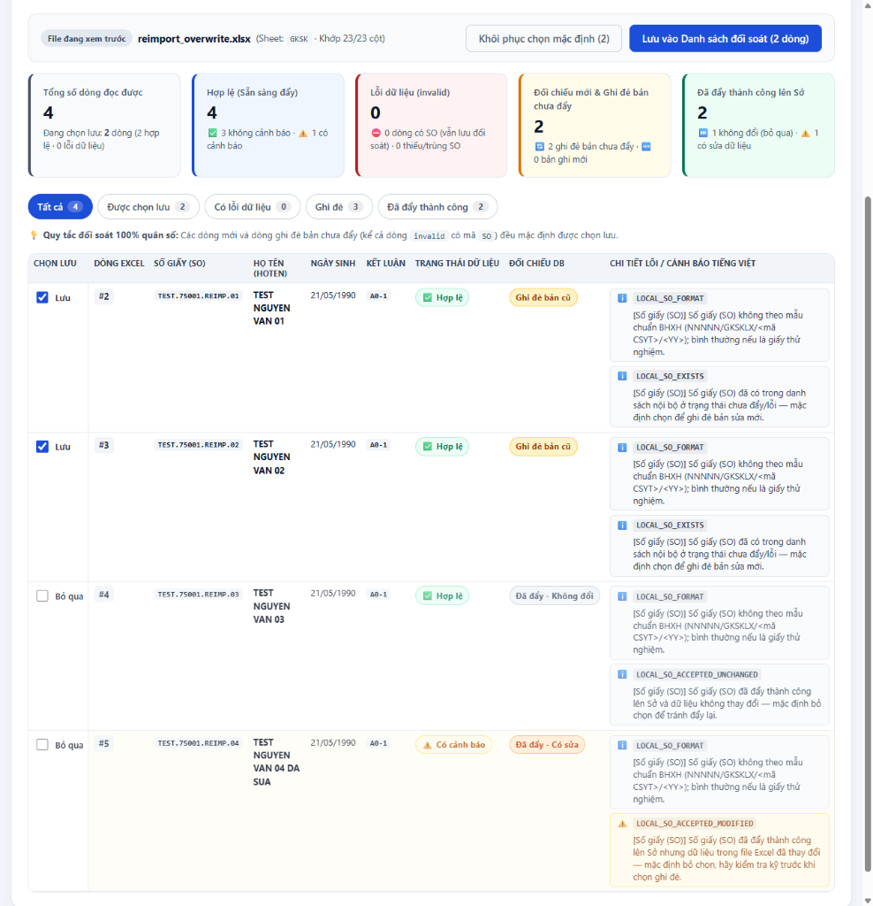

4. Bấm nút **Lưu vào Danh sách đối soát** → hệ thống tự động chuyển về trang **Danh sách & Đối soát** đã lọc sẵn theo đợt import vừa tạo.

---

## Bước 4 — Kiểm tra 4 Tab Đối soát & Xem Chi tiết (Ngăn trượt Drawer)

Trên màn hình **Danh sách & Đối soát**, 4 thẻ thống kê và 4 Tab lọc nhanh giúp theo dõi ngay quân số:
- **Tất cả**: Toàn bộ giấy đã import có mã `SO`.
- **Chưa đẩy (Sẵn sàng)**: Giấy hợp lệ (`🟦 Chờ đẩy cổng`), sẵn sàng xuất XML và đẩy lên Sở.
- **Đã đẩy thành công**: Giấy đã được Hệ thống Sở tiếp nhận (`✅ Đã đẩy thành công`).
- **Cần xử lý**: Gồm 3 bộ lọc con rõ ràng: `⛔ Lỗi dữ liệu Excel`, `⛔ Cổng Sở từ chối`, và `⚠️ Lỗi mạng / Cấu hình`.

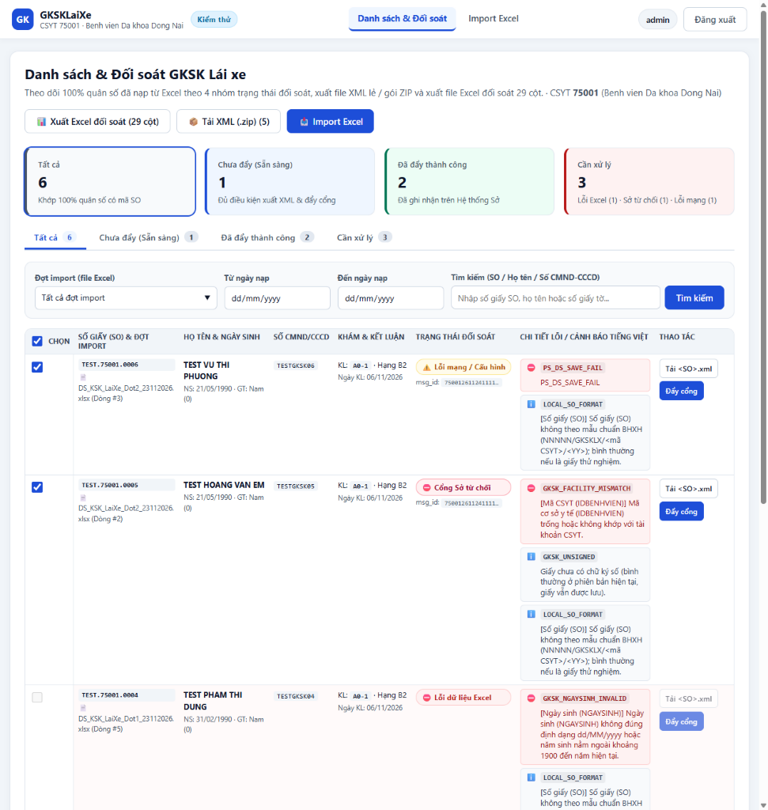

Bạn có thể lọc theo **Đợt import (file Excel)**, khoảng ngày hoặc tìm kiếm nhanh theo `SO`, `HOTEN`, `SOCMND_PASSPORT`.

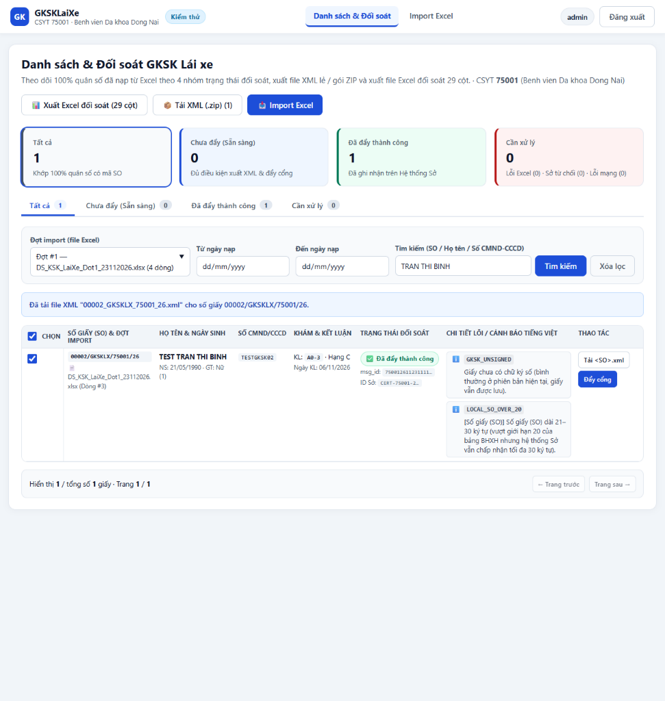

### Xem chi tiết 1 giấy bằng Ngăn trượt (Drawer) bên phải
Bấm trực tiếp vào **Số giấy (`SO`)** hoặc nút **Chi tiết** trên dòng để mở Ngăn trượt bên phải (giữ nguyên bộ lọc và vị trí cuộn của bảng):

- **Tab 1 — Thông tin giấy (25 trường chỉ đọc)**:
  - Hiển thị danh sách lỗi/cảnh báo bằng tiếng Việt dễ hiểu.
  - Tách riêng nhóm **🔒 4 trường thông tin y tế nhạy cảm** (`NONGDOCON`, `MATUY`, `LYDO`, `TINHTRANGBENH`) — 4 trường này được ẩn hoàn toàn trên bảng danh sách chung để bảo mật thông tin bệnh nhân.

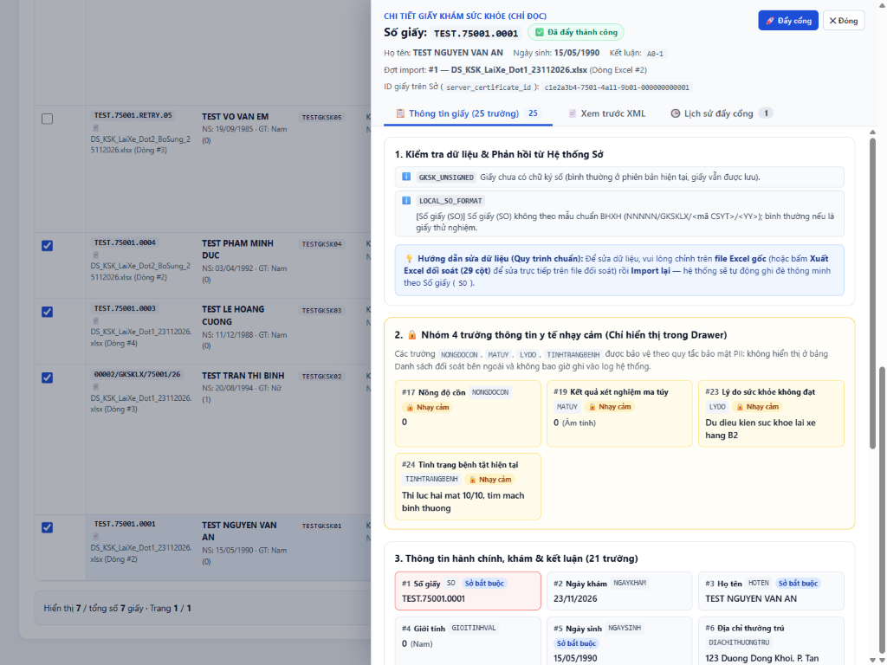

- **Tab 2 — Xem trước XML**:
  - Xem toàn bộ mã nguồn XML chuẩn 25 thẻ theo thứ tự BHXH, bấm **Sao chép XML** hoặc **Tải `<SO>.xml`** lẻ.

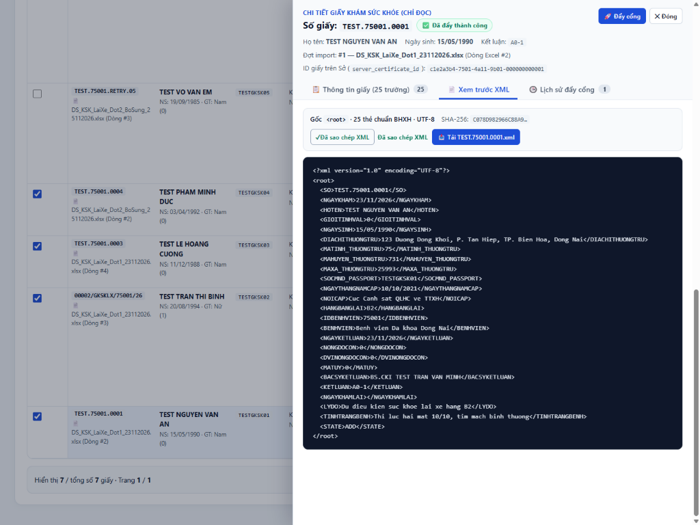

- **Tab 3 — Lịch sử đẩy cổng**:
  - Xem đầy đủ `msg_id`, số lần thử, thời gian gửi (giờ Việt Nam `UTC+7`), `server_submission_id`, `server_certificate_id`, mã lỗi/cảnh báo từ Sở và nút **🔍 Tra lại trạng thái** trực tiếp trên Hệ thống Sở.

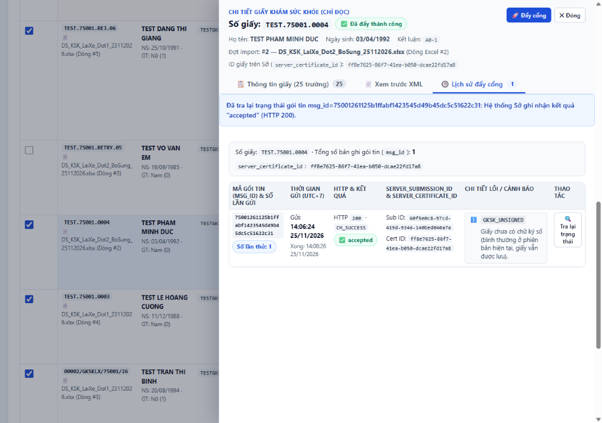

---

## Bước 5 — Xuất XML (`.xml` lẻ / `.zip` hàng loạt) & Đẩy cổng Sở Y tế

### 5.1 Xuất file XML
- **Xuất lẻ**: Bấm nút **XML** trên từng dòng hợp lệ (hoặc trong Tab 2 của Drawer) để tải file `<SO>.xml`.
- **Xuất hàng loạt (`.zip`)**: Tick chọn nhiều giấy hợp lệ → bấm **📦 Tải XML (.zip)** để tải về 1 file nén `GKSK_XML_<YYYYMMDD_HHmmss>.zip` chứa toàn bộ các file `<SO>.xml`.

### 5.2 Đẩy cổng Sở Y tế Đồng Nai
1. **Đẩy lẻ 1 giấy**: Bấm nút **Đẩy cổng** ngay trên dòng giấy ở trạng thái `Chờ đẩy cổng`.
2. **Đẩy hàng loạt**: Tick chọn các giấy cần đẩy → bấm **🚀 Đẩy cổng các giấy đã chọn**.
3. Hộp thoại xác nhận sẽ hiện ra (ở môi trường `production` bắt buộc tick xác nhận gửi lên cổng thật). Sau khi xác nhận, **thanh tiến độ** cập nhật trực tiếp mỗi giây số giấy đã xử lý, thành công, bị Sở từ chối hoặc lỗi mạng.

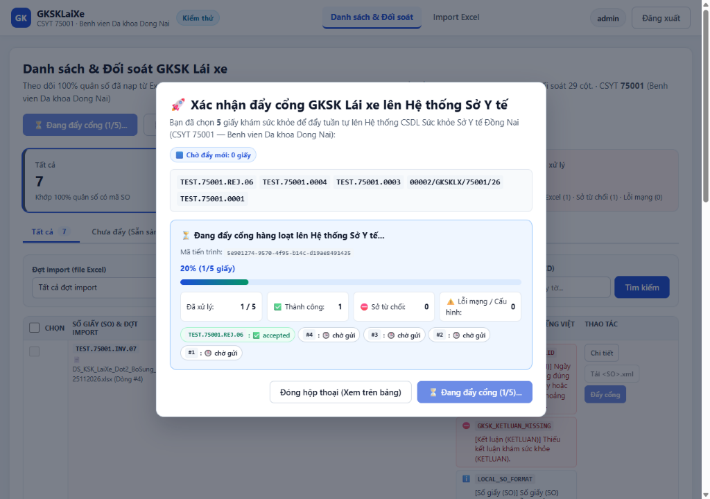

> **Giải thích cảnh báo `GKSK_UNSIGNED`**: Khi giấy được đẩy thành công (`✅ Đã đẩy thành công`) và có dòng thông tin `GKSK_UNSIGNED` (*Giấy chưa có chữ ký số*), đây là **kết quả bình thường** ở phiên bản v1 — giấy đã được Hệ thống Sở tiếp nhận và lưu thành công.

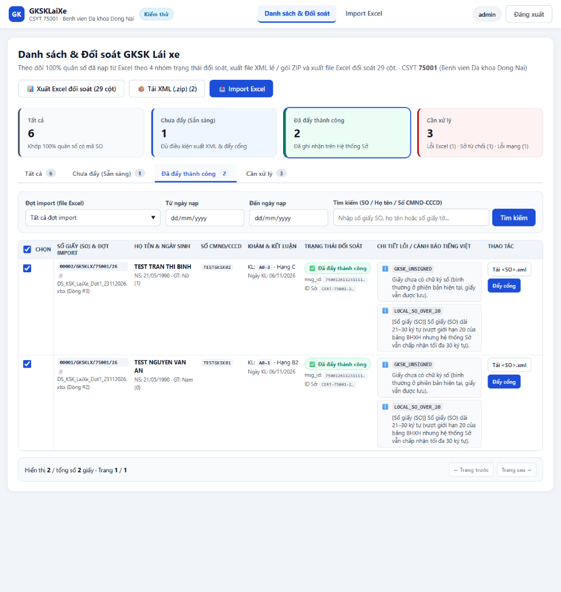

### 5.3 Xử lý khi gặp Lỗi mạng tạm thời (Gửi lại giữ nguyên `msg_id`)
Nếu mạng chập chờn hoặc máy chủ Sở tạm thời gián đoạn, giấy sẽ chuyển sang tab **Cần xử lý** với trạng thái `⚠️ Lỗi mạng / Cấu hình` và hiện nút **🔄 Gửi lại**:
- Khi mạng ổn định trở lại, chỉ cần bấm **🔄 Gửi lại**. Hệ thống tự động kiểm tra trạng thái trên Sở trước rồi gửi lại với **đúng `msg_id` ban đầu** để đảm bảo **không bao giờ bị trùng giấy**.

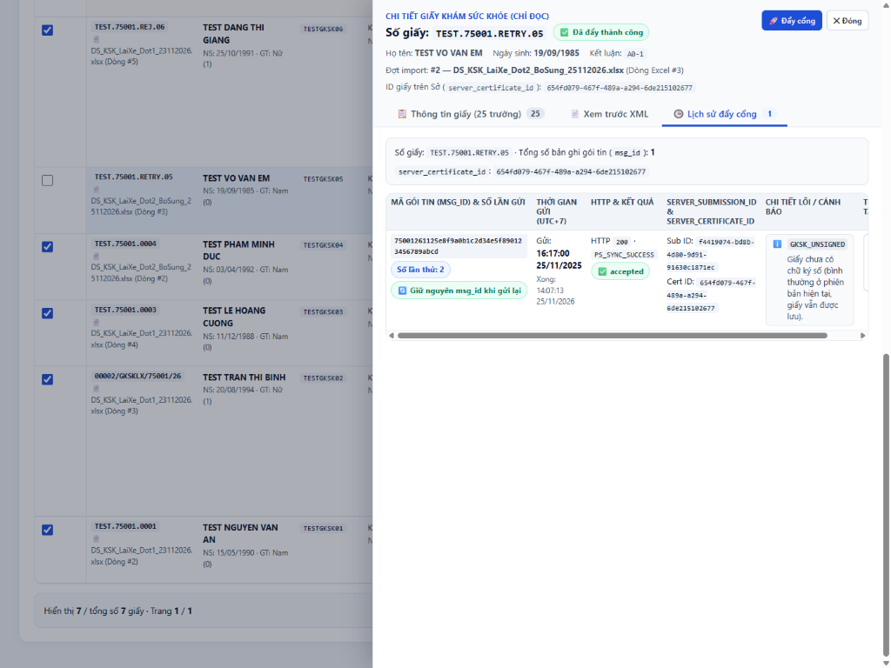

---

## Bước 6 — Xuất File Excel Đối soát 29 Cột & Sửa lỗi Nhanh

1. Trên màn hình **Danh sách & Đối soát**, chọn bộ lọc mong muốn (ví dụ theo Đợt import hoặc tab **Cần xử lý**) rồi bấm nút **📊 Xuất Excel đối soát (29 cột)**.

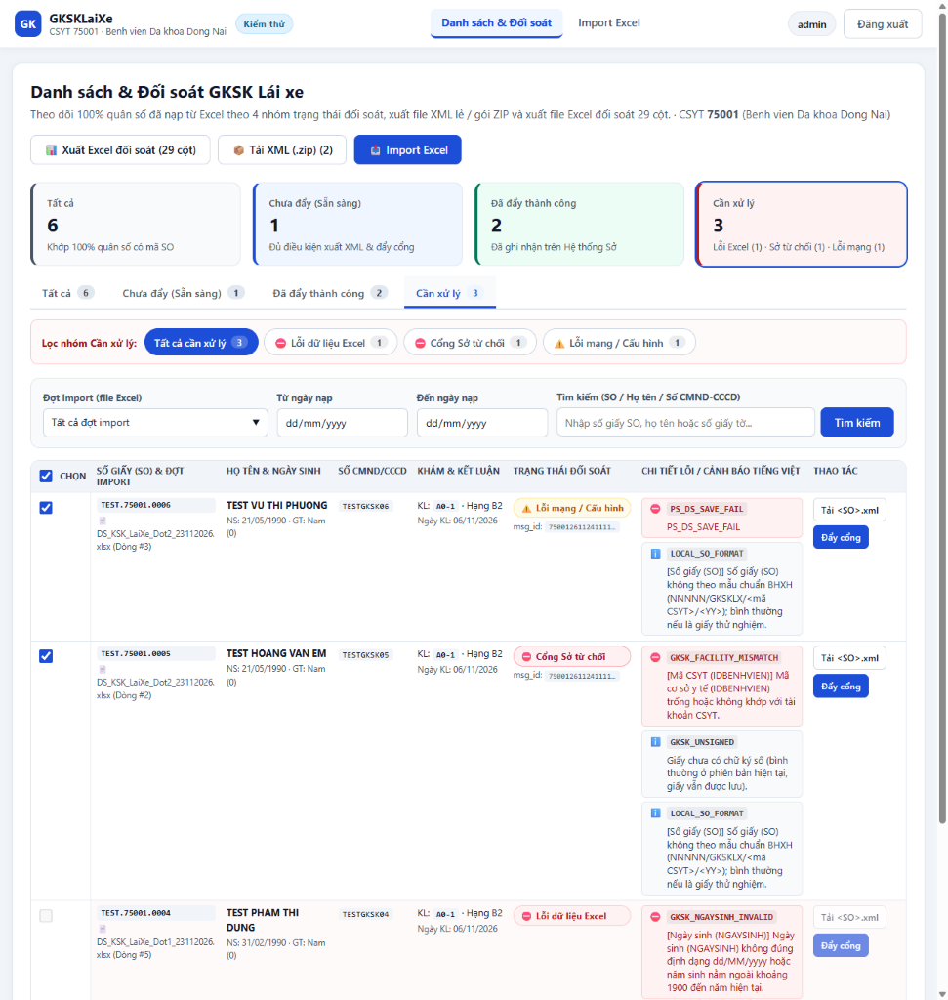

2. File tải về (`GKSK_doi_soat_<YYYYMMDD_HHmmss>.xlsx`) gồm:
   - **23 cột dữ liệu gốc** (đúng thứ tự và định dạng Text như file mẫu).
   - **6 cột đối soát ở cuối**: `TRANG_THAI_DOI_SOAT`, `DOT_IMPORT`, `THOI_GIAN_DAY`, `MSG_ID`, `CERTIFICATE_ID_SO`, `CHI_TIET_LOI_CANH_BAO`.
3. **Cách sửa lỗi nhanh nhất**:
   - Mở trực tiếp file Excel đối soát 29 cột vừa tải.
   - Lọc các dòng có lỗi ở cột `TRANG_THAI_DOI_SOAT` / `CHI_TIET_LOI_CANH_BAO`, sửa lại dữ liệu sai ngay trên các cột gốc (ví dụ sửa `NGAYSINH` sai) rồi lưu file (**không cần xóa 6 cột đối soát ở cuối**).
   - Vào trang **Import Excel** và nạp lại chính file Excel đối soát này: hệ thống tự động bỏ qua 6 cột đối soát, tự bỏ chọn các giấy đã đẩy thành công, và **chỉ tự động tick chọn các dòng bạn vừa sửa** để lưu đè và đẩy cổng tiếp!

---

## Xử lý Nhanh Một số Tình huống Thường gặp

| Tình huống | Cách xử lý |
|---|---|
| Số CCCD bị mất số `0` ở đầu sau khi mở Excel | Luôn dùng file mẫu tải từ ứng dụng (đã đặt định dạng Text `@`). Nếu nhập trong Excel thường, đặt định dạng cột `SOCMND_PASSPORT` là **Text** hoặc thêm dấu nháy đơn `'` trước số CCCD. |
| Cảnh báo `LOCAL_FIELD_OVER_SPEC` / `GKSK_FIELD_TOO_LONG` | Giá trị dài hơn quy định độ dài BHXH (ví dụ `NOICAP` > 30 ký tự). Cảnh báo này **không chặn gửi** — Hệ thống Sở vẫn tiếp nhận nguyên vẹn, nhưng nên rút gọn cho chuẩn dữ liệu BHXH. |
| Lỗi `GKSK_FACILITY_MISMATCH` | Mã `IDBENHVIEN` trong file Excel khác mã CSYT cấu hình trên server. Xóa cột `IDBENHVIEN` trong file Excel (để hệ thống tự điền) rồi Import đè lại. |
| Giấy bị kẹt sau khi máy chủ mất điện đột ngột | Khi máy chủ khởi động lại, hệ thống tự động chuyển giấy đang gửi dở về `⚠️ Lỗi mạng / Cấu hình`. Chỉ cần vào tab **Cần xử lý** bấm **🔄 Gửi lại**. |
